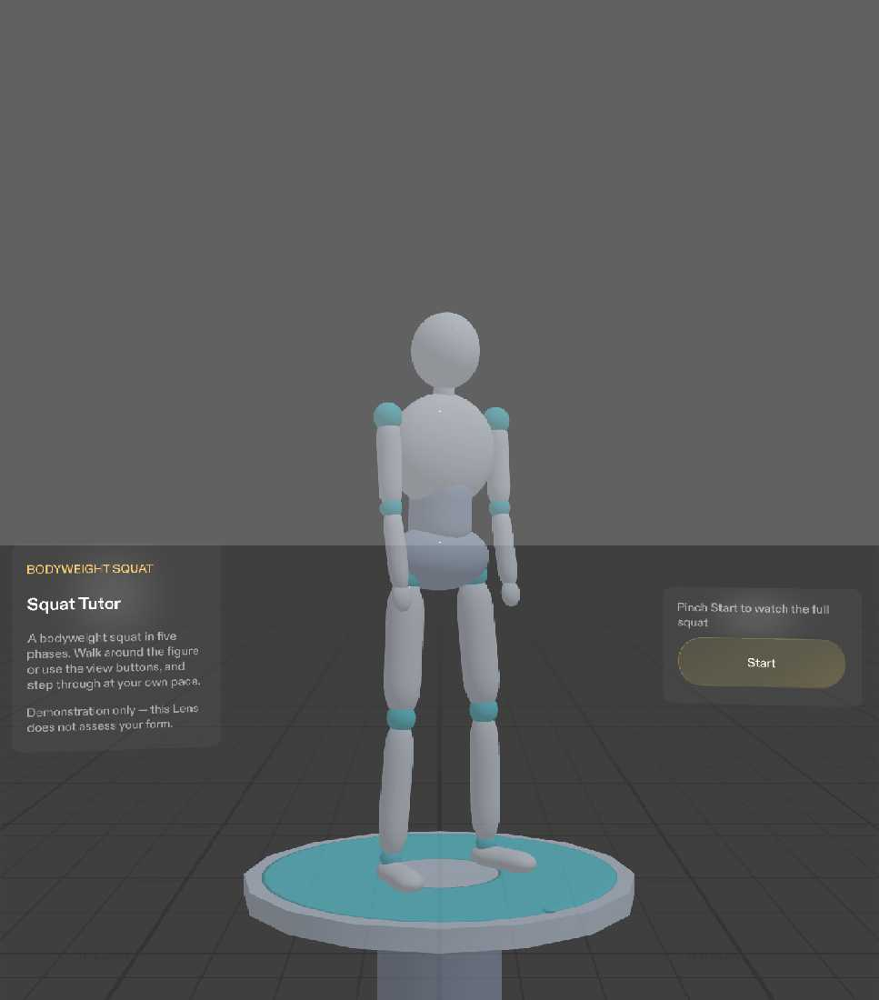
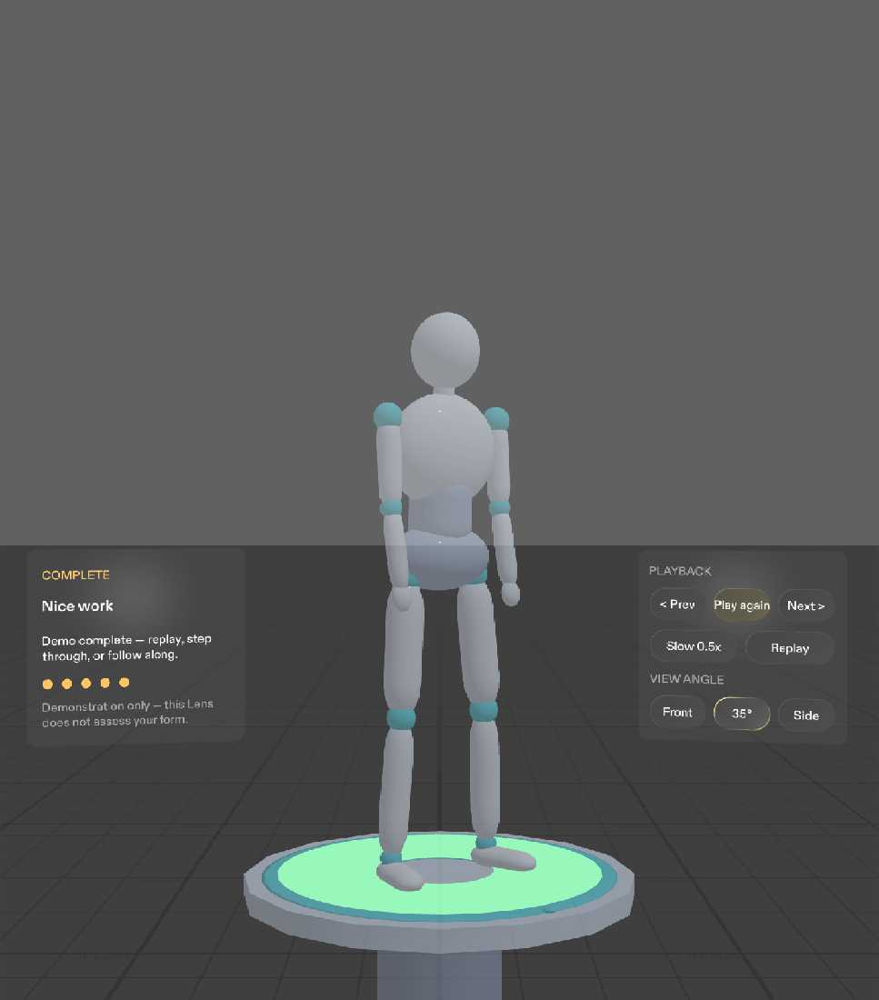
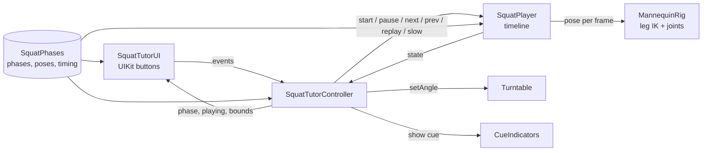

# Squat Tutor

**A spatial 3D movement tutor for SPECS: a jointed mannequin demonstrates a bodyweight squat in five phases, in your space. You can watch it, step through it, slow it down, and view it from any angle.**

Built for the [Learn AR with SPECS](https://learn-specs.devpost.com) hackathon with Lens Studio 5.24.1, CLAD, and the Lens Studio MCP. Everything shown here runs in Lens Studio's preview. No SPECS hardware was used.


## Why glasses

People learning a movement usually re-watch a fixed-angle phone video and still can't see what the hips and knees are doing from the angle that matters. Squat Tutor puts a scale demonstration on a stand in front of you, about 1.7 m away, so you can watch from the front, at 35°, or from the side. You can also walk around it. Your hands stay free to follow along.

> **Product hypothesis.** This need hasn't been validated with users, and no user research is claimed.

> **Demonstration only.** This Lens does not track, count, or assess your body. It shows general guidance, not individual fitness or medical advice.

## What it does

| | |
|---|---|
|  |  |
| **Intro.** Title, a short explanation, the disclaimer, and one Start button. | **1 · Starting Stance:** "Stand tall, feet shoulder-width apart." Foot outlines highlight. |
|  |  |
| **2 · Controlled Descent:** "Lower with control; knees follow your toes." Knee arrows point along the toes. | **3 · Bottom Position:** "Reach a comfortable depth with control." A hip marker shows the hips sitting back. |
|  |  |
| **4 · Rising Up:** "Rise smoothly while keeping your balance." | **5 · Standing Finish:** "Finish tall and balanced." The completion ring lights up. |

**Controls.** These are UIKit buttons, pinched with a hand or clicked in the preview:
- **Playback:** Start, Play/Pause, Previous, Next, Slow (0.5x), Replay.
- **View angle:** Front / 35° / Side turns the turntable. Walking around the figure also works.
- **Stepping:** Previous and Next disable at the ends.
- **Completion:** the demo stops on "Demo complete — replay, step through, or follow along." It doesn't restart on its own.

| Front | 35° | Side |
|---|---|---|
|  |  |  |



*All screenshots are captures of the running Lens in the Lens Studio preview (SPECS 27 device, Interactive input), taken from the user's start position.*

## AR design decisions
- **Scale over life size.** The preview's SPECS view measures about 32° wide by 36° tall. A 175 cm figure only fits at about 3.7 m. A 60 cm figure at 1.7 m keeps head, feet, knees, and hips in view through the whole squat.
- **One composition.** The cue card (left), figure (centre), and controls (right) sit in a band about 1.55–1.7 m away, so everything is visible from the start position.
- **One cue at a time.** Each phase shows exactly one body highlight: feet, then knees, then hips, then knees, then a finish ring.
- **Big, few targets.** Eight buttons in three rows, with toggle states for speed and view angle.
- **Additive display.** Light materials and light text; nothing depends on black.

Details are in [`docs/RESEARCH_AND_DECISIONS.md`](docs/RESEARCH_AND_DECISIONS.md) and the approved brief in [`Lens/devpost/design-brief.md`](Lens/devpost/design-brief.md).

## How it's built



- **Mannequin.** It's a real scene hierarchy of rounded primitives under joint pivots: pelvis, spine, neck, shoulders, elbows, hips, knees, ankles. It was generated with the Lens Studio MCP (`VirtualScene`) from [`tools/generate_mannequin_scene.py`](tools/generate_mannequin_scene.py).
- **Animation.** Each leg uses analytic two-bone IK to a fixed ankle, bending toward the toes, so the feet stay planted at every frame of every blend. Torso lean, neck, and arm reach are joint angles. Phases blend with an ease-in-out curve: five 1.5 s holds and four 1.2 s transitions make 12.3 s at 1x.
- **UI.** Spectacles UI Kit (`BackPlate`, `FlexLayout`, `Button`) on top of the Spectacles Interaction Kit.
- **Workflow.** Planning used the Devpost Learn `plan-lens` skill. The build used Claude Code with CLAD skills (scene construction, Lens API, UI Kit, LEAF) through the Lens Studio MCP: VirtualScene, TypeScript compile, logs, preview capture, and LEAF runs.

Script responsibilities and the scene tree are in [`docs/IMPLEMENTATION_NOTES.md`](docs/IMPLEMENTATION_NOTES.md).

## Testing

Six LEAF scenarios, one per done criterion, run in the Lens Studio preview. They pinch the real buttons and measure scene state. **All six pass:**

| Scenario | Measured |
|---|---|
| Placement | 170 cm away, starts at 35.0°, root moves 0.000 cm while animating |
| Full demo | Phases 1→5 in order with matching cues; 12.08 s; no auto-restart |
| Stepping | Knee 64.6° / 123.3° / 71.7° / 5.5° match the targets; ends disabled |
| Playback | Paused joints frozen; 1x 12.27 s vs 0.5x 24.58 s (ratio 2.00) |
| Angles | 0.0° / 35.0° / 90.0°; figure stays put; playback continues |
| Cues | Exactly one correct cue per phase |

Full results and the manual checks are in [`docs/TEST_RESULTS.md`](docs/TEST_RESULTS.md).

## Run it
1. Install **Lens Studio 5.24.1**.
2. Clone the repo and open `Lens/Lens.esproj`.
3. In the Preview panel, choose device **SPECS 27** and **Interactive** input.
4. Click **Start**. A mouse click acts as a pinch. Use **WASD** to walk, **Q/E** to go down and up, and right-drag to look around.
5. To run the tests, open the LEAF panel and run `a-placement` to `f-cues`.

## Repository layout
```
Lens/                      Lens Studio project
  Assets/Scripts/          Squat Tutor TypeScript (+ Tests/ for LEAF)
  Assets/Meshes, Materials Mannequin primitives and materials
  Packages/                SpectaclesInteractionKit 2.0, SpectaclesUIKit 2.0, Leaf 2.0.2, Bitmoji 3D
  devpost/design-brief.md  Approved plan-lens brief
docs/                      Decisions, implementation notes, test results, build log, screenshots
tools/                     Scene generator for the mannequin hierarchy
```

## Known limitations
- Fit and comfort were judged in the preview only. Real see-through comfort, hand tracking, and following along are feel unproven.
- In Side view at the bottom of the squat, the fingertips reach the control panel's inner edge.
- The completion ring is a broad band rather than a thin ring.
