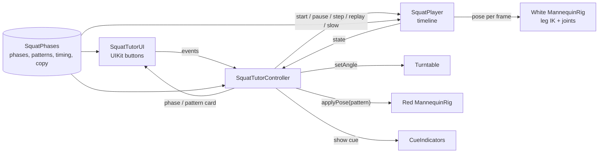

# Squat Tutor: Coach's Eye

**See what a common squat pattern looks like next to the target, from the angle where the difference shows. In your own space, on SPECS.**

A jointed 3D figure demonstrates a bodyweight squat on a small stage in front of you. Press **Knees**, **Heels** or **Chest**, and a translucent red figure shows an exaggerated version of that common movement pattern over the white reference figure. The stage turns to a view chosen to show the difference, and a short card names the pattern, says what differs, and says what the white reference does.

Built for the [Learn AR with SPECS](https://learn-specs.devpost.com) hackathon with Lens Studio 5.24.1, CLAD and the Lens Studio MCP. Everything shown runs in Lens Studio's preview; no SPECS hardware was used.

| Knees caving in (front) | Heels lifting (side) | Chest dropping (side) |
|---|---|---|
|  |  |  |

*Red = an exaggerated, illustrative version of a common movement pattern. White = the visual target this demonstration uses as its reference, not a universal ideal. Only the difference is drawn in red.*

> **Demonstration only.** The Lens does not track, count or assess your body. It makes no diagnostic, clinical or injury-prevention claims, and it is not fitness or medical advice.

## The learning problem
- **Who it's for:** beginners learning the bodyweight squat at home who want to know *what to look for* and *where to look*.
- **The problem:** most people learn from a video filmed from one angle. Coaches don't watch from one angle: trainer screening checks the knees from the front and torso lean from the side. A single view can hide exactly the difference a beginner needs to see.
- **What already exists:** phone apps rotate 3D exercise models and list common mistakes (see the [strategic analysis](docs/STRATEGIC_HACKATHON_ANALYSIS.md)).
- **What's different here:** an exaggerated pattern and the reference figure are overlaid in your space, and the stage turns for you to a view selected for that difference.

> **Hypothesis, not yet validated.** No user testing has been done yet. A ready-to-run five-person protocol is in [`docs/USER_VALIDATION_PLAN.md`](docs/USER_VALIDATION_PLAN.md).

## Why spatial
Phone AR can also place 3D figures in a room. What glasses change is how you inspect the comparison:
- **Head-worn, hands-free viewing.** The figures stay on the stage while you look from where you stand, step to the side or walk behind it, without holding a phone in your line of sight.
- **The view matters.** Each pattern shows most clearly from a particular side (knees from the front, torso lean from the side), so the Lens turns the stage to face you with that view.
- **Sized for the glasses' view.** The SPECS preview shows about 32° x 36°. A 1:3-scale figure at 1.7 m keeps head, feet, cue card and controls in view together; a life-size figure would need about 3.7 m.

**On glasses, as intended (untested):** look around the comparison hands-free, and perhaps try the movement beside the figure. No follow-along feature is built. Comfort, usability and any learning benefit haven't been tested on a device or with users.

## The experience

| | |
|---|---|
|  |  |
| **1. Open.** The intro says what you'll do: watch a squat in five phases, then compare three common patterns, each from the angle where it shows. Press **Start**. | **2. Watch.** About 12 s through five phases, each with one short cue and one body highlight (feet, knees, hips, knees, finish ring). |
|  |  |
| **3. Compare.** **Knees**, **Heels** or **Chest** pauses at the bottom, shows the red pattern, and turns the stage. The card reads, top to bottom: the view (e.g. "Best seen from the front"), the pattern name, "Red: …", "White (target): …", then "Pinch again to return". | **4. Finish.** The demo stops on "Squat complete. Try Knees, Heels or Chest below to compare a common pattern, or Replay." It doesn't restart on its own. |

**Controls** (UIKit buttons, pinched with a hand or clicked in the preview):
- **Playback:** Start, Play/Pause, Prev, Next, Slow 0.5x, Replay. Prev and Next dim at the ends.
- **View:** Front / 35° / Side turns the turntable; walking around the figure also works.
- **Compare common patterns:** Knees, Heels, Chest. Press the same button again, or any playback control, to return to the demonstration.

| Starting stance | Controlled descent | Rising up | Standing finish |
|---|---|---|---|
|  |  |  |  |

| Front | 35° | Side |
|---|---|---|
|  |  |  |

*All screenshots are real captures of this build running in the Lens Studio preview (SPECS 27 device, Interactive input). See the [screenshot index](docs/screenshots/README.md).*

## The three patterns
| Pattern | View the Lens turns to | What you should see | Notes |
|---|---|---|---|
| Knees caving in | Front | Red knees closer together than the feet; white knees over the feet | Front-view knee checks are standard in trainer screening |
| Heels lifting | Side, automatically. Rear is another useful view; the Lens doesn't turn to it, but you can walk behind the stage. The card says "Seen from the side or rear" | A gap under the red heel; the red foot tilts | The legs also re-solve, so the red thigh and shin move too. Our own captures show this is the least clear comparison |
| Chest dropping | Side | Red torso and head tipped further forward | More lean isn't always wrong; it depends on body proportions and depth |

How each pattern is posed is documented in [`docs/BIOMECHANICAL_VALIDATION.md`](docs/BIOMECHANICAL_VALIDATION.md). That is an internal model-geometry check of our own mannequin, not an expert biomechanical assessment, and its values don't establish a correct or ideal squat.

## How it's built



- **Mannequin.** A scene hierarchy of rounded primitives under joint pivots, generated through the Lens Studio MCP (`VirtualScene`) from [`tools/generate_mannequin_scene.py`](tools/generate_mannequin_scene.py). The red overlay figure comes from [`tools/generate_fault_ghost.py`](tools/generate_fault_ghost.py).
- **Animation.** Analytic two-bone leg IK to fixed ankles keeps the feet planted at every frame. Torso, neck and arms are joint angles. Phases blend with an ease-in-out curve: 12.3 s at 1x.
- **Pattern overlay.** A second rig with identical proportions under the same turntable, in a translucent unlit material. Its meshes are inset 4% inside the target, so only the differences render. Each pattern is posed by one primary parameter on the Bottom Position: knee bend direction, heel lift with foot pitch, or extra torso lean. Other joints can move as a result; for heels, the legs re-solve.
- **Cues.** Thin rings are torus meshes generated at runtime with `MeshBuilder`.
- **UI.** Spectacles UI Kit (`BackPlate`, `FlexLayout`, `Button`) on the Spectacles Interaction Kit.
- **Workflow.** Planning used the Devpost Learn `plan-lens` skill, with the Coach's Eye change recorded as an amendment in [`Lens/devpost/design-brief.md`](Lens/devpost/design-brief.md). The build used Claude Code with CLAD skills through the Lens Studio MCP: VirtualScene, TypeScript compile, logs, preview capture and LEAF.

Details: [`docs/RECOMMENDED_PRODUCT_ARCHITECTURE.md`](docs/RECOMMENDED_PRODUCT_ARCHITECTURE.md), [`docs/IMPLEMENTATION_NOTES.md`](docs/IMPLEMENTATION_NOTES.md).

## Tools and technologies
Lens Studio 5.24.1 · SPECS (SPECS 27 preview) · TypeScript · Spectacles Interaction Kit 2.0 · Spectacles UI Kit 2.0 · LEAF 2.0.2 · CLAD · Lens Studio MCP · Claude Code

## Testing
Eight LEAF scenarios run in the Lens Studio preview. They pinch the real buttons and read scene state. **All eight pass on the final build** (31 Oct 2026): placement, the full five-phase demo, stepping, pause/slow/replay, viewing angles, one cue per phase, interaction edge cases, and the pattern comparison. The last one checks, for each pattern:
- the red figure appears at the bottom position, paused;
- the stage turns to that pattern's view, starting from a different angle each time;
- the card shows the exact view label, title, red and target lines, return hint and exaggeration note, with only that toggle on;
- the red figure differs from the white in the intended direction.

It also checks that Slow and the angle buttons keep a comparison open, and that each of the five exits (same button, Play, Prev, Next, Replay) restores the normal card.

Measured values and manual checks: [`docs/TEST_RESULTS.md`](docs/TEST_RESULTS.md).

## Run it
1. Install **Lens Studio 5.24.1**.
2. Clone the repo, check out `feature/coach-eye` (or `main` for the version without comparisons), and open `Lens/Lens.esproj`.
3. In the Preview panel choose device **SPECS 27** and **Interactive** input, then click **Reset**.
4. Click **Start**. A click acts as a pinch. **WASD** walks, **Q/E** moves down and up, and right-drag looks around.
5. Tests: open the LEAF panel and run `a-placement` … `h-mistake-compare`, one at a time.

## Repository layout
```
Lens/                      Lens Studio project
  Assets/Scripts/          TypeScript (+ Tests/ for LEAF)
  Assets/Meshes, Materials Mannequin primitives and materials
  Packages/                SpectaclesInteractionKit 2.0, SpectaclesUIKit 2.0, Leaf 2.0.2, Bitmoji 3D
  devpost/design-brief.md  plan-lens brief + Coach's Eye amendment
docs/                      Validation, tests, decisions, demo and submission material, screenshots
tools/                     Scene generators for the mannequin and the overlay figure
```

## Limitations and responsible use
- **Preview only.** Comfort, hand tracking and the legibility of red on an additive display are unverified on SPECS hardware ([device checklist](docs/DEVICE_VALIDATION.md)).
- **Not user-tested yet.** The learning benefit is a hypothesis.
- **Not coach-reviewed.** The three depictions are general, simplified, 1:3-scale and deliberately exaggerated. The heels comparison is the least clear.
- **Small buttons.** Buttons are 3.4 cm tall at about 1.55 m, smaller than the brief's default; comfort with real hand tracking is untested.
- **No tracking or assessment.** By design, the Lens never looks at the user. It doesn't diagnose, correct, or claim to prevent injury.
- **One movement, three patterns.** The bodyweight squat only; the three patterns are illustrative choices for this prototype, not an exhaustive or validated list. Applying the approach to other movements is only a future possibility; nothing beyond the squat is built.

## Project status
- **Branch `feature/coach-eye`:** Coach's Eye, the candidate for submission. The learner-led `plan-lens` interview is complete (1 Nov 2026), and the revised design-brief amendment awaits the learner's sign-off. Not merged; the merge waits for the owner's approval.
- **Branch `main` (`d1d0473`):** the verified fallback, without comparisons.
- **Next:** five-person understanding test, live review on 5 Nov, then the demo video.

## Documents
- **Product and validation:** [Model-geometry validation](docs/BIOMECHANICAL_VALIDATION.md) · [User validation plan](docs/USER_VALIDATION_PLAN.md) · [Live review package](docs/LIVE_REVIEW_PACKAGE.md) · [Strategic analysis](docs/STRATEGIC_HACKATHON_ANALYSIS.md) · [Architecture](docs/RECOMMENDED_PRODUCT_ARCHITECTURE.md)
- **Submission:** [Final demo script](docs/FINAL_DEMO_SCRIPT.md) · [Recording guide](docs/FINAL_DEMO_RECORDING_GUIDE.md) · [Devpost draft](docs/FINAL_DEVPOST_SUBMISSION.md) · [Submission checklist](docs/SUBMISSION_CHECKLIST.md)
- **Engineering:** [Test results](docs/TEST_RESULTS.md) · [Implementation notes](docs/IMPLEMENTATION_NOTES.md) · [Research and decisions](docs/RESEARCH_AND_DECISIONS.md) · [Build log](docs/BUILD_PROGRESS.md) · [Device checklist](docs/DEVICE_VALIDATION.md)
