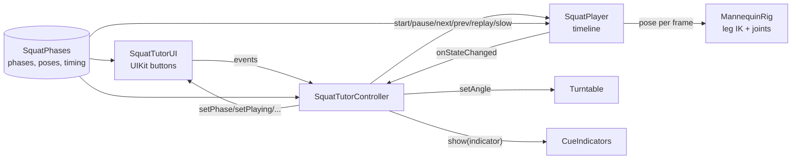

# Implementation notes

## Scene structure (`Lens/Assets/Scene.scene`)

```
Camera Object (Camera, DeviceTracking)       Lighting
SpectaclesInteractionKit                     LeafIndex (test registry)
SquatTutor
├── Stage (0, −42, −170)   [cue rings use RingMesh]
│   ├── Stand: StandColumn, StandTop
│   └── Turntable (yaw 35°): TurntableRing, TurntableFrontMark
│       └── Mannequin [MannequinRig]
│           ├── Pelvis: PelvisMesh, Cue_HipMarker (ring + arrow)
│           │   ├── Spine: AbdomenMesh, ChestMesh
│           │   │   ├── Neck: NeckMesh, Head
│           │   │   └── ShoulderL/R: ball, UpperArm, Elbow: ball, Forearm, Hand
│           │   └── HipL/R: ball, Thigh, Knee: ball, Shin, Ankle: ball, Foot
│           └── Cues: Cue_FootOutlines, Cue_KneeArrows, Cue_CompletionRing
├── SquatTutorUI [SquatTutorUI]   (builds LeftSlot and RightSlot at runtime)
└── Systems [SquatPlayer, Turntable, CueIndicators, SquatTutorController]
```

All units are cm. The mannequin faces +Z in its own space. The figure is about 60 cm tall, with 15.5 cm thigh and shin bones. Every body part is a rounded primitive (capsule or sphere) under a joint pivot. `tools/generate_mannequin_scene.py` regenerates the hierarchy as VirtualScene instructions.

## Scripts (`Lens/Assets/Scripts/`)

| File | Responsibility |
|---|---|
| `SquatPhases.ts` | Single source of truth: five phases (title, cue, cue indicator, pose), timing constants, view angles, easing, pose interpolation. |
| `MannequinRig.ts` | Applies a pose. Each leg uses analytic two-bone IK from the hip to a fixed ankle, bending toward the toe direction, so feet never slide. Torso lean, neck counter-tilt, and arm reach are joint angles. Positions the knee arrows. Exposes the knee flexion (solver and measured) for tests. |
| `SquatPlayer.ts` | Deterministic timeline: five 1.5 s holds and four 1.2 s transitions (12.3 s at 1x). Phase k becomes active when the movement into it begins. Covers pause and resume, 0.5x, eased 0.6 s Next/Previous steps that leave playback paused, Replay, completion without auto-restart, and wall-clock timing of uninterrupted runs. |
| `Turntable.ts` | Eased 0.6 s yaw to 0° / 35° / 90°. Rotates only the turntable, so the joint animation is untouched. |
| `RingMesh.ts` | Builds a thin torus at runtime with `MeshBuilder` (independent major and tube radius, CCW winding verified) and swaps it onto the object's existing renderer. Used for the foot outlines, hip ring, turntable ring, and completion ring. |
| `CueIndicators.ts` | Shows exactly one cue group per phase, with a gentle per-child pulse. |
| `SquatTutorUI.ts` | UIKit UI: intro card and Start (before start), then the cue card and control panel. BackPlate + FlexLayout + Button, text sized by the Specs type scale at 155 cm. Main → UI uses `set*` methods; UI → main uses events. |
| `SquatTutorController.ts` | Wires UI events to the player and turntable, and renders player state into the UI and cues. Toggles the pattern comparison (red overlay rig, Bottom Position, view turn, card). Has an optional capture hook (`startPhase`, `startAngle`, `startFault`), off by default. |
| `Tests/*` | LEAF scenarios A–G (six done criteria plus edge cases), `SquatTestKit` helpers, `LeafIndex` registry. |

## Data flow



## Gotchas found during the build
- **`FlexLayout.addItems()` before init throws** when `autoDiscoverItemsOnStart` is on (the default). An exception in `onAwake` makes Lens Studio stop rendering after five failed frames, and the preview shows "Paused by Creator". Children with a `FlexItem` are discovered automatically.
- **`@input` defaults must be literals.** A default that references an imported constant serializes as 0 in the scene.
- **Leaf 4.0.0 targets the renamed `InteractionKit` 4.0.** This project uses `SpectaclesInteractionKit` 2.0.0, so LEAF 2.0.2 is the matching release.
- **The preview helpers behind `QueryRuntimeSceneTool`, `PreviewInteractTool`, and `CaptureRuntimeViewTool` install `AiPreviewAgentInspect`.** That package needs `UIKit` and `InteractionKit` 4.0 and breaks this project's compile. Don't use those tools here.
- **Lens Studio 5.24's Agents-Docs plugin deletes `Lens/.agents/` on save.** It's tracked in Git and restored before commits.

## Running
1. Open `Lens/Lens.esproj` in Lens Studio 5.24.1.
2. In the Preview panel, choose device SPECS 27 and Interactive input.
3. Click Start (a mouse click is a pinch). Use WASD to move, Q/E to go down and up, and right-drag to look around.
