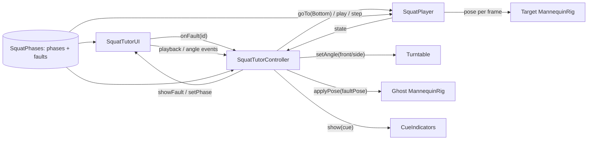

# Recommended product architecture: Squat Tutor: Coach's Eye

Branch: `feature/coach-eye` (final build `2201d21`, 8/8 LEAF pass). Product direction approved by the owner on 31 Oct 2026; not merged. Fallback: `main` (`d1d0473`). Platform: Lens Studio 5.24.1, SPECS preview, SpectaclesInteractionKit 2.0, SpectaclesUIKit 2.0, LEAF 2.0.2.

## Scene hierarchy
```
SquatTutor
├── Stage (0, −42, −170)
│   ├── Stand: column + plate
│   └── Turntable (yaw 0 / 35 / 90°) [Turntable]
│       ├── TurntableRing [RingMesh], TurntableFrontMark
│       ├── Mannequin [MannequinRig]            solid "target" figure + Cues
│       └── GhostMannequin                       translucent red "pattern" figure (hidden by default)
│           └── GhostPelvis > … (same joints, meshes inset 4%, GhostMistakeMaterial)
├── SquatTutorUI [SquatTutorUI]                  cue card (left) + control panel (right), built at runtime
└── Systems [SquatPlayer, Turntable, CueIndicators, SquatTutorController, MannequinRig (ghost)]
LeafIndex [LeafIndex]                            8 LEAF scenarios
```

## Components and responsibilities
| Component | Role | Status |
|---|---|---|
| `SquatPhases.ts` | Phase data, timing and all user-facing copy (intro, completion, compare labels, exaggeration note); **`SQUAT_FAULTS`** (id, button, title, view, `viewLabel`, red and target lines, one pose delta); `faultPose()` | Implemented |
| `MannequinRig.ts` | Two-bone leg IK with planted feet; **knee-in bend direction**, **heel lift with foot pitch**; optional knee arrows | Implemented |
| `SquatPlayer.ts` | Deterministic timeline; **`goTo(phase)`** for comparisons | Implemented |
| `Turntable.ts` | Eased yaw presets | Implemented (unchanged) |
| `CueIndicators.ts` | One pulsing body cue at a time | Implemented (unchanged) |
| `RingMesh.ts` | Thin runtime torus for the ring cues | Implemented (unchanged) |
| `SquatTutorUI.ts` | UIKit panels; **"Compare common patterns" row**; `showFault()` card mode (view label, title, Red / White (target) lines, "Pinch again to return", exaggeration note), restored on exit | Implemented |
| `SquatTutorController.ts` | Wiring; **fault toggle** (shows the ghost, goes to the Bottom Position, turns to the checkpoint view, highlights the relevant body cue); any playback control exits the comparison | Implemented |

## Data flow


## State model
`started × playing × complete × slow × phaseIndex` (player) plus `activeFault | null` (controller).
- Selecting a fault: paused, phase = Bottom, view = the fault's checkpoint, ghost visible.
- Selecting the same fault again, or Start, Play, Prev, Next, or Replay: ghost hidden, normal phase card.
- Slow and the angle buttons don't exit a comparison. The user may rotate freely while comparing.

## Rendering approach for the overlay
- The ghost uses Unlit, `blendMode: Normal`, alpha 0.55, and `depthWrite: false`, and draws after the opaque target.
- **Ghost meshes are scaled to 96%**, so wherever the two poses coincide the ghost sits inside the target and fails the depth test. Only the *difference* is visible: red knees inside the white knees, red heels raised (with the legs re-solved, so the thigh and shin also show), red torso tipped forward. This was found and fixed through preview captures (the first version tinted the whole figure).

## Capability status
| Capability | Status |
|---|---|
| Articulated rig, IK, playback, turntable, UIKit UI, LEAF | Implemented and tested (8/8) |
| Fault poses and ghost overlay, checkpoint auto-angle | Implemented and tested (`h-mistake-compare`) |
| Walking around in the preview (WASD) | Supported by the preview; manual check only |
| Hand pinch on SPECS hardware | Supported by SIK; **unverified on a device** |
| Additive-display legibility of 55% red | **Unverified.** Needs glasses |
| Body tracking, form assessment | **Out of scope by design**; not used |

## Testing strategy
- LEAF a–g regression (placement, demo, stepping, playback, angles, cues, edge cases), plus **h-mistake-compare**. That last one checks, for each pattern:
  - the view yaw, starting from a different angle each time;
  - the paused Bottom Position;
  - the exact card text, return hint, exaggeration note and toggle states;
  - that the red joints differ from the white in the intended direction (internal model geometry on a 1:3 figure; caveats in `BIOMECHANICAL_VALIDATION.md`).

  It also checks that Slow and the angle buttons keep a comparison open, and all five exits (same button, Play, Prev, Next, Replay).
- Preview captures for each mistake (`docs/screenshots/13–15`).

## Technical risks
| Risk | Mitigation |
|---|---|
| Overlay hard to read on the additive display | Inset approach keeps red to the difference only; alpha and colour are tunable in one material |
| Pattern depictions judged inaccurate or read as assessment | Internal model-geometry check in `BIOMECHANICAL_VALIDATION.md` (not an expert assessment); one change per pattern (the chest arm change was removed); "common pattern" wording, exaggeration note, per-pattern view label (heels: side or rear); coach review planned, not done |
| Scope creep before the deadline | Feature set frozen to three mistakes; `main` remains the fallback |

## Implementation sequence (done on the branch)
1. Fault data and rig support → 2. ghost hierarchy (generator) → 3. controller and UI → 4. visual fixes from captures (inset, magnitudes, copy, arm clearance) → 5. LEAF h → 6. full regression → 7. comprehension pass (intro, completion, view labels, return hint, exaggeration note) → 8. fixes from the internal model-geometry check (chest arms, heels view label) → 9. final 8/8 regression → 10. test H extended to every pattern and exit.
